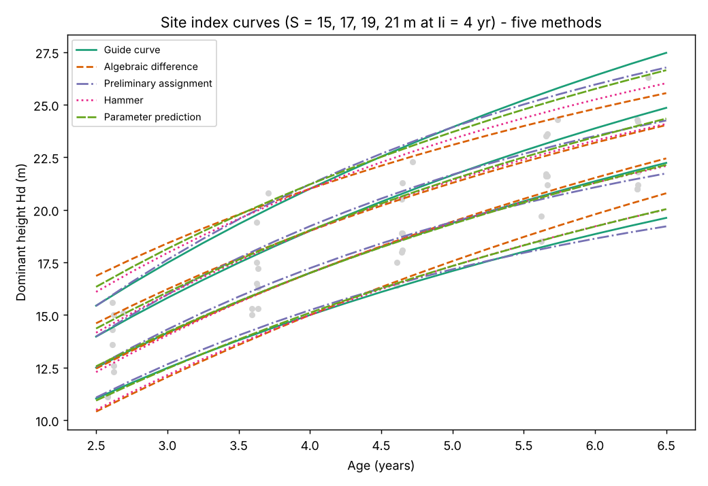

# Report — Data Challenge 07: Site Productive Capacity Classification

Project C531 · 9 permanent plots · 43 measurements · ages 2.6–6.4 yr · Hd 11.1–26.3 m.
Index age **Ii = 4 yr**; site-index classes **S = 15, 17, 19, 21 m**; base model **Chapman-Richards**
Hd = b0·(1 − e^(−b1·t))^b2 (see README for the reasons).

## 1. Results of each method

| Method | Fitted model | Fit (own response) | Curve family |
|---|---|---|---|
| 1. Guide curve | b0 = 34.05, b1 = 0.1556, b2 = 0.846 | R² 0.787, Syx 1.81 m (9.7%), 43 points | anamorphic |
| 2. Algebraic difference | b0 = 34.85, b1 = 0.1366 (b2 isolated) | R² 0.851, Syx 1.05 m (5.0%), 82 pairs | **polymorphic** |
| 3. Preliminary assignment | Hd = (0.400 + 1.499·S)(1 − e^(−0.2993t))^1.131 | R² 0.972, Syx 0.66 m (3.6%), 43 points | anamorphic |
| 4. Hammer | (26.12 + 1.787z)(1 − e^(−0.2212t))^(1.151 − 0.0925z) | R² 0.988, Syx 0.50 m (2.7%), 15 class means | polymorphic |
| 5. Parameter prediction | b0 = 12.71 + 1.150·S ; b2 = 1.319 − 0.0286·S ; b1 = 0.1556 | R² 0.971, Syx 0.68 m (3.7%), 43 points | polymorphic |

**These statistics must not be ranked against each other.** They describe different data: all 43
points pooled (method 1), pairs of measurements (2), plot means by class (4), or 43 points in which
each plot's S is already known (3 and 5). The first method looks "worst" only because it must explain
differences between plots with one curve; the others are given the site information.

Guide-curve candidates (Part 1): Chapman-Richards, Backman and Schumacher gave Syx of 1.812, 1.814
and 1.809 m — no real difference, so Chapman-Richards was kept as the common base model.

## 2. Plot classification

| Plot | Guide curve | Algebraic diff. | Preliminary | Hammer | Param. prediction |
|---|---|---|---|---|---|
| 1-1 | 15 | 15 | 15 | 15 | 15 |
| 1-5 | 15 | 15 | 15 | **17** | 15 |
| 2-2 | 19 | 19 | 19 | 19 | 19 |
| 2-3 | 17 | 17 | 17 | 17 | 17 |
| 2-5 | 17 | 17 | 17 | 17 | 17 |
| 3-1 | 17 | 17 | 17 | 17 | 17 |
| 3-2 | 19 | 19 | 19 | 19 | 19 |
| 3-3 | 17 | 17 | 17 | 17 | 17 |
| 6-1 | 21 | 21 | 21 | 21 | 21 |

Eight of nine plots get the same class from all five methods. The only disagreement is plot 1-5,
whose Hammer index is S = 16.00 m, exactly halfway between classes 15 and 17, so the split is a
rounding effect and not a real difference. In plain words: **the choice of method changes the curves
slightly, but not which plots are good or poor sites.**

## 3. Answers to the questions in the challenge

**Algebraic difference — anamorphic or polymorphic?** Depends on which parameter is eliminated.
Isolating b0 gives anamorphic curves (same shape as the guide curve) but fits worse (sum of squares
113.7 against 88.7). Isolating b2 gives polymorphic curves and fits clearly better, so it was used.
The shape test makes this visible: Hd(S=21)/Hd(S=15) is 1.40 at every age for the guide curve
(anamorphic), but falls from 1.62 at 2.5 yr to 1.23 at 6.5 yr for the algebraic difference — better
sites are relatively taller when young and the curves converge with age. Caution: that convergence
comes from the common asymptote (b0 = 34.85) the model assumes; with data only up to 6.4 years the
data cannot confirm what happens at older ages.

**Preliminary assignment — did any plot change class?** No. Re-classifying with the final model
moved S by at most 0.22 m and no plot changed class. This is expected and should not be over-read:
the preliminary S came from the same 43 points that were then used to fit the model, so the final
model largely reproduces it (a circular check). It shows the procedure is self-consistent, not that
the preliminary classes are correct. The covariate form also matters: only the asymptote depended on
S in the selected model (AIC 92.67 against 92.68 and 93.13 for the alternatives, i.e. no real
difference), so the curves are anamorphic.

**Hammer — when is it preferable?** Hammer needs no plot to be followed through time: each age class
is analysed alone. It is the better choice when the data are a single-visit inventory, temporary
plots, or plots measured at different ages, i.e. when no longitudinal series exist — typical of
operational forest inventories. The guide curve and algebraic difference need either a representative
age distribution or repeated measurements of the same plot. Its weaknesses show here: plots are
ranked again in every age class (a plot can change rank between rounds), it needs several plots per
age class (3 per productivity class here, 2 in the last round), and the final model was fitted to
only 15 class means, so its high R² (0.988) says little.

**Parameter prediction — how strong are the relations?** Weak. b0 rises with S (R² 0.42,
p = 0.059) and b2 does not depend on S significantly (R² 0.21, p = 0.21). Both were kept in the
equation, as the method requires, but with 9 plots the relations are uncertain. The equation is
not exact at the index age: the curves labelled S = 15, 17, 19, 21 pass through 15.1, 17.0, 19.0 and
21.2 m at 4 years (errors up to 0.2 m).

## 4. Evaluation of the methods

| Method | Strengths | Limitations seen in this data |
|---|---|---|
| Guide curve | Simplest; needs no repeated measurement; S has a direct formula. | Forces equal shape (anamorphic); explains only 79% of the variation because plot differences are left out. If plots of different sites sit at different ages the curve is biased. |
| Algebraic difference | Uses the longitudinal structure; no site covariate needed; allows polymorphism; best fit per parameter used. | Needs repeated measurements; pairs from one plot are not independent; shape beyond 6.4 yr rests on the model. |
| Preliminary assignment | Easy to run; S becomes an ordinary covariate. | Depends on the first classification and is circular; here it reproduces the guide curve. |
| Hammer | Works without longitudinal data. | Rank groups are noisy with 7–9 plots; few points fitted; sensitive to the age classes chosen. |
| Parameter prediction | One explicit equation Hd = f(t, S), polymorphic. | A free fit per plot is unstable with 4–5 points (b0 ranged 20.7–41.0), so b1 had to be fixed; parameter–S relations are weak. |

## 5. Limitations of the whole study

- **Small sample:** 9 plots in 4 stands, 43 measurements, ages 2.6–6.4 years. The index age (4 yr) is
  well inside this range, but eucalyptus stands are usually harvested at 6–8 years, so the upper part of
  every family is close to or beyond the data.
- **No external validation:** every fit is in-sample.
- **Classes are relative to this data:** S = 15–21 m at 4 yr covers these plots only. A stand growing
  faster or slower than all nine would need new classes.
- **Recommendation:** for classifying stands of this project, the algebraic difference (polymorphic)
  is the best-supported method here — it uses the repeated measurements and has the best fit among
  the methods that use all the data. The guide curve is an acceptable quick alternative: it gives
  the same class as the algebraic difference for all 9 plots.

## 6. About these numbers

All values come from a Python implementation of the same algorithms as the R scripts (no R was
available to run them); the R scripts should reproduce them, apart from small differences in the last
decimals of the nonlinear fits. Chapter 10 of the textbook was not available, so formulas follow the
challenge text and standard Chapman-Richards difference equations.
